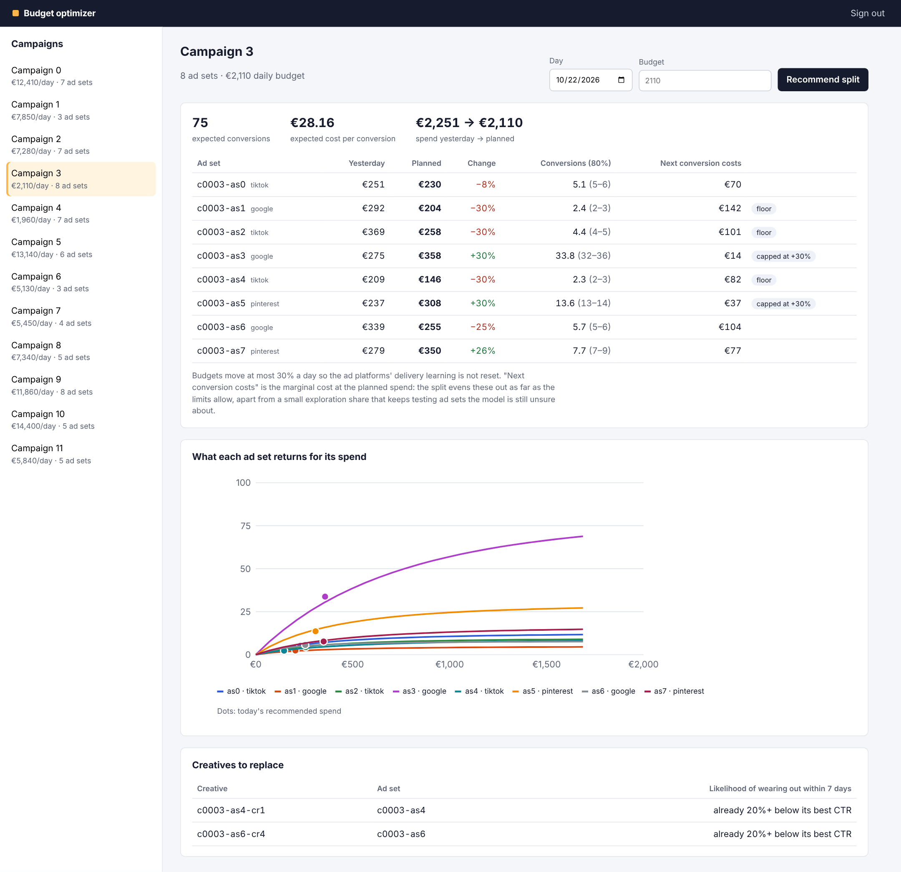

# Campaign budget optimizer

A service that tells an advertiser how to split tomorrow's daily budget across the ad sets of a
campaign, and which creatives are about to wear out. It covers the whole path from a data
scientist's model to an API with an SLO:

- **Bayesian spend-response curves** for each ad set, fitted from daily spend and conversions, with
  uncertainty;
- a **budget allocator** that equalises the marginal cost of the next conversion across ad sets,
  within guardrails that keep ad platforms' delivery stable;
- a **creative-fatigue classifier**, trained in PyTorch, gated against the "replace after two weeks"
  rule, registered in MLflow, and served from NumPy;
- a **multi-tenant FastAPI service + background worker on PostgreSQL**, with Prometheus metrics,
  SLOs, burn-rate alerts and runbooks;
- a **React + TypeScript dashboard**;
- **Docker, Kubernetes (kustomize), Terraform (AWS)** and CI that runs an SLO load test on every push.



## Results

All numbers come from a simulated ad market with known ground truth (see
[Limits](#limits)). They are reproducible with the commands below.

### Budget policies — 60 campaigns × 60 days, the same market for every policy

Each policy runs every campaign after a 21-day warm-up on an even split. The simulated market uses
common random numbers, so policies see the same drift, creative changes and noise. Uplift is the
percentage change in expected conversions at the same spend, against the weekly rule of thumb.
The 95% intervals are bootstrapped over campaigns.

| Policy | Uplift vs rule of thumb | Cost per conversion | Campaigns better | Share of oracle gain | Daily budget moved |
|---|---|---|---|---|---|
| Rule of thumb (move 20% weekly toward the best cost per conversion) | — | €48.82 | — | — | 0.4% |
| Even split | −7.35% (−8.8 to −5.9) | €52.70 | 5% | — | 0% |
| Greedy on the posterior mean | +4.78% (+2.4 to +7.6) | €46.60 | 70% | 67% | 2.2% |
| Thompson sampling | +4.68% (+2.4 to +7.3) | €46.64 | 70% | 65% | 7.7% |
| **Damped Thompson (default)** | **+4.87% (+2.5 to +7.6)** | **€46.56** | **73%** | **68%** | **3.7%** |
| Oracle (knows the true curves) | +7.17% (+4.9 to +9.9) | €45.56 | 93% | 100% | 3.0% |

What this shows:

- Fitting curves and reallocating daily gets about two thirds of the oracle's gain. Cost per
  conversion falls 4.6% at the same spend.
- Damped Thompson is the default. It blends the posterior mean with 30% of one posterior draw, so
  uncertain ad sets keep getting tested. It moves half as much budget per day as plain Thompson,
  for the same or better result.
- Exploration adds little over greedy *in this market*. The curves are well identified after the
  warm-up, so the difference is inside the noise. The real argument for it is new ad sets and
  drifting audiences, and this simulation understates both.

### Creative fatigue — held-out campaigns

The label asks whether CTR over the next 7 days will drop below 70% of the creative's best 3-day
CTR. Only creatives that still look healthy are scored: CTR at least 80% of peak, age at least
3 days. Flagging a creative that has already collapsed is easy and useless; the point is a week's
warning.

| | Model | "Replace after 2 weeks" rule |
|---|---|---|
| ROC-AUC | **0.930** | 0.478 |
| PR-AUC (positive rate 11%) | **0.707** | 0.104 |
| Precision / recall at alert threshold | **76% / 50%** | 10% / 19% |
| Expected calibration error | 0.013 | — |

The AUC difference has a 95% interval of +0.38 to +0.53, bootstrapped over campaigns. The NumPy
serving path matches PyTorch to 3e-7.

### Service — SLO load test

The SLO: 99% of recommendations within 300 ms, and 99.9% availability.

Each CI run starts the API (2 uvicorn workers) and PostgreSQL, pushes 20 campaigns × 60 days of
stats through the API, fits them with the worker, then runs 60 s of morning traffic with 20
users. The mix is 70% recommendations, 20% campaign reads and 10% stats deliveries. The build fails
if recommendation p99 is above 300 ms or the error rate is above 0.1%.

| Run | Requests | Failures | Throughput | Recommendation p50 / p95 / p99 |
|---|---|---|---|---|
| 2-vCPU dev container | 7,941 | 0 | 134 req/s | 23 / 65 / 98 ms |
| GitHub Actions runner, two runs | 7,565 / 7,378 | 0 | 125–128 req/s | 24 / 140–200 / 210–290 ms |

The first version failed this test, with a p99 of 440 ms on the runner. Its allocator ran a
numerical solve for every ad set inside every step of the outer bisection. The current version
tabulates each ad set's marginal return once per request, on a 2,049-point grid. It then bisects
with one vectorised interpolation per step, and draws the posterior intervals for all ad sets in
one pass. Recommendation compute, including the database reads, fell from about 40 ms to about
10 ms.

## How it works

```
 ad platforms ──daily stats──▶ POST /v1/campaigns/{id}/stats ──▶ daily_stats, creative_daily
                                        │ enqueue (one queued job per campaign)
                                        ▼
                     worker (FOR UPDATE SKIP LOCKED, retries, dead letter)
                       ├─ fit response curve per ad set ──▶ posteriors (jsonb)
                       └─ score current creatives ────────▶ fatigue_scores
                                        │
 campaign tool ──▶ POST /v1/campaigns/{id}/recommendations
                     reads posteriors, allocates within guardrails, never fits on the request path
```

**Response curves** (`src/cbo/model/response.py`). Each ad set is modelled as
`conversions ~ Poisson(a · (1 − e^(−spend/k)) · weekday)`:

- For each `k` on a 25-point log grid, a Gamma prior on `a` is conjugate. The posterior over `k`
  then comes from the exact marginal likelihood.
- Observations are down-weighted by 0.97^age (a half-life of about 23 days), so curves follow
  drift and creative changes.
- The prior on `a` is centred on the platform's pooled cost per conversion, so a new ad set starts
  from a sensible guess.
- The posterior is a small JSON document stored in PostgreSQL.

**Allocation** (`src/cbo/optim/allocate.py`) is water-filling on the marginal return. It works
within a per-ad-set corridor of ±30% of yesterday's spend, a floor of 3% of the budget, and a
minimum of €10. When the budget itself changes more than that corridor allows, the corridor
widens in proportion, and the response and the dashboard say so. A test checks the allocator
against brute force.

**Fatigue model** (`src/cbo/fatigue/`):

- A 2-layer MLP is trained in PyTorch and temperature-scaled on a validation split. The data is
  split by campaign, so no campaign appears in two splits.
- `cbo train-fatigue` promotes the model only when three checks pass: the AUC beats the age rule
  with a 95% interval above zero, ECE ≤ 0.05, and the NumPy and PyTorch outputs agree. The model
  is registered in MLflow with the `champion` alias.
- The API and worker images load the exported weights and carry neither PyTorch nor MLflow.

**Service** (`src/cbo/api`, `src/cbo/worker`, `src/cbo/db`):

- **Tenancy:** API keys are stored as SHA-256 hashes, and every query is scoped to the caller's
  tenant.
- **Ingest:** stats are upserted idempotently, with batches capped at 5,000 rows and validated.
- **Jobs:** a partial unique index keeps at most one queued refresh per campaign. Leased jobs
  retry with backoff, then go to a dead letter.
- **Recommendations:** an `Idempotency-Key` header returns the stored answer. Without one, the same
  campaign and day still give the same answer, because the Thompson draw is seeded by both. Each
  response says how old the model behind it is.
- **Migrations** run under an advisory lock.
- **Observability:** JSON logs carry the request id, and Prometheus metrics cover requests, queue
  depth, the oldest queued job, dead jobs and fit duration.

**Operations** (`docs/slo.md`, `ops/`, `deploy/`):

- **SLOs:** availability, latency and freshness, each with multi-window burn-rate alerts (14.4× over
  1 h/5 min and 6× over 6 h/30 min) and runbooks.
- **Kubernetes** (kustomize):
  - API deployment with HPA, PDB, probes and a non-root, read-only root filesystem;
  - worker deployment and a migration Job;
  - NetworkPolicy, ServiceMonitor and PrometheusRule.
- **Terraform:** an ECR repository, plus RDS PostgreSQL 16 (Multi-AZ, KMS-encrypted, in private
  subnets).
- **Grafana:** a dashboard provisioned for docker compose.

## Run it

```bash
# everything: PostgreSQL, trainer (fits and gates the fatigue model), API, worker, dashboard, Prometheus, Grafana
docker compose up --build
docker compose run --rm seed            # creates a tenant, prints its API key, loads 20 simulated campaigns
open http://localhost:8080              # dashboard; paste the API key
```

Without Docker (Python 3.13, a local PostgreSQL in `DATABASE_URL`):

```bash
pip install -r requirements-dev.txt -r requirements-train.txt && pip install --no-deps -e .
cbo migrate
cbo train-fatigue                       # writes data/fatigue_model.json and the report; exits 5 if the gate fails
cbo evaluate --campaigns 60 --days 60   # the policy table above
cbo serve & cbo worker &
KEY=$(cbo create-tenant demo) && cbo seed --key "$KEY" --campaigns 10
pytest                                   # 26 tests; database tests need DATABASE_URL
cd web && npm ci && npm test && npm run dev
```

API, with a key from `cbo create-tenant`:

```bash
curl -s -X POST localhost:8000/v1/campaigns/c0003/recommendations \
  -H "Authorization: Bearer $KEY" -H "Idempotency-Key: plan-2026-10-22" \
  -H "Content-Type: application/json" -d '{"day": "2026-10-22"}'
```

| Endpoint | |
|---|---|
| `PUT /v1/campaigns/{id}` | create or update a campaign and its ad sets |
| `POST /v1/campaigns/{id}/stats` | daily spend, impressions, clicks, conversions per ad set (and creative); queues a refit |
| `POST /v1/campaigns/{id}/recommendations` | split for a day; optional budget, policy and guardrails |
| `GET /v1/campaigns/{id}/recommendations/latest` | last stored recommendation |
| `GET /v1/campaigns/{id}/creatives/at-risk` | creatives likely to wear out within 7 days |
| `GET /v1/campaigns[/{id}]` | campaigns; one campaign with its fitted curves |
| `/health`, `/ready`, `/metrics` | liveness, readiness (database), Prometheus |

## Limits

- **The market is simulated.** Response curves, platform effects, drift and creative fatigue are
  modelled on how paid social behaves, but they are not real advertiser data. On real data, the
  curve family and the fatigue label need validating first. The policy evaluation is the template
  for that: an offline replay first, then a holdout of campaigns.
- **Conversions are attributed to the day of spend.** There is no attribution window, no
  cross-ad-set cannibalisation, and no auction feedback from our own bids.
- **Exploration was not shown to pay off here.** The damped version is the default because it
  matches greedy and keeps learning at low churn, not because it was proven better.
- **Terraform and the Kubernetes manifests are validated in CI but not deployed.** CI runs
  `terraform validate` and `kubectl kustomize` with a schema check.
- **The load test ran on a CI runner and a dev container,** not on production-sized pods behind a
  load balancer. On the shared runner the p99 varies between runs (210–290 ms), so the margin to
  the 300 ms objective there is thin; the dev container has much more headroom (98 ms).

## Repository

```
src/cbo/sim        simulated market and budget policies, offline evaluation
src/cbo/model      Bayesian response curves
src/cbo/optim      allocator and guardrails
src/cbo/fatigue    fatigue features, PyTorch training, NumPy serving, gate, MLflow registry
src/cbo/api        FastAPI service       src/cbo/worker   job worker       src/cbo/db   pool, migrations
web/               React + TypeScript dashboard (Vite, TanStack Query, SVG charts)
deploy/            Kubernetes (kustomize) and Terraform (AWS)
ops/               Prometheus rules and scrape config, Grafana dashboard
loadtest/          Locust traffic and the SLO check
docs/slo.md        SLOs, burn-rate alerts, runbooks
```

MIT licensed.
